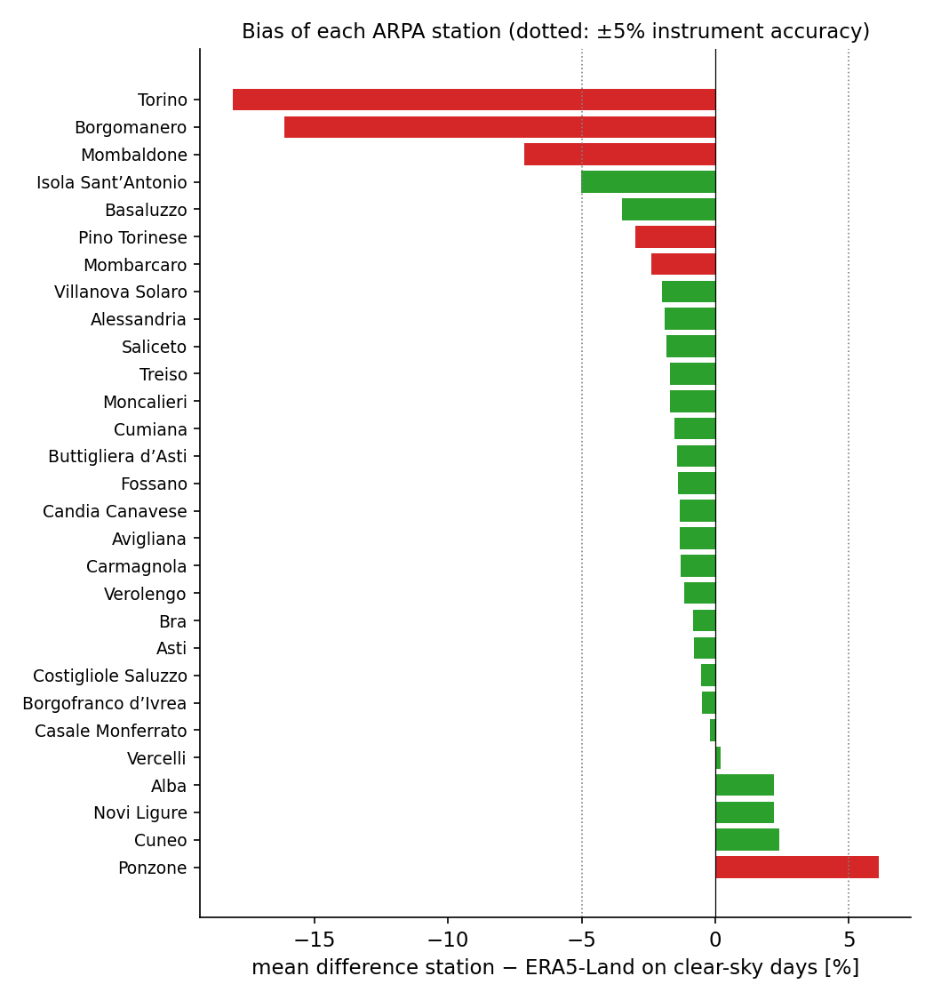
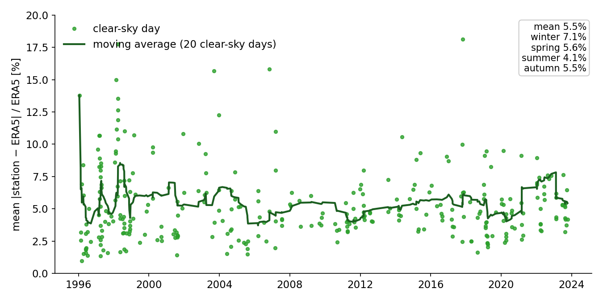
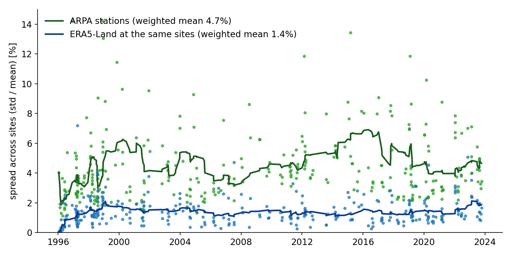

# Validation of solar radiation measurements in Piedmont

Global horizontal irradiance (GHI) drives photosynthesis and is an input of agricultural models such
as iVine, but pyranometers need regular maintenance and their data can silently degrade. This project
checks how reliable the daily radiation data of the regional monitoring networks in Piedmont are,
by comparing 28 years of measurements with the **ERA5-Land** reanalysis and a **clear-sky model**,
finding problematic stations and estimating the real accuracy of the instruments.

*Bachelor's thesis in Physics, University of Turin, carried out during an internship with
ARPA Piemonte and Regione Piemonte (2023–2024). Supervisor: Claudio Cassardo;
co-supervisor: Federico Spanna.*

**Published as:** V. Bargero, *Validazione del dato di radiazione solare in Piemonte*,
[NEC – la rivista di AMPRO](https://www.meteoprofessionisti.it/nec-la-rivista-di-ampro/), no. 58, 2024 (in Italian).



*Mean difference between each ARPA station and ERA5-Land on clear-sky days. Most stations are within
the ±5% accuracy of the instrument. The six stations in red were excluded: on-site inspection and
satellite images showed external factors interfering with the measurement, such as trees
(Borgomanero, Mombaldone) or a telecommunication tower (Mombarcaro).*

## Method

The quantity measured is the **global horizontal irradiance** (GHI = direct normal irradiance ·
cos θ + diffuse horizontal irradiance), measured by thermopile pyranometers (CAE, WMO first class,
5% accuracy on the daily total).

1. **Two networks, one reference.** Daily data of the agrometeorological network of Regione
   Piemonte (RAM) and of the ARPA Piemonte network (29 stations, 1996–2023) were matched with the
   nearest ERA5-Land grid point (0.07° ≈ 11 km; hourly radiation and low/medium/high cloud cover)
   and compared by linear regression. The RAM stations gave slopes far from 1 (0.63 to 1.31) and were
   judged unreliable; the ARPA data were consistent and were analysed further.
2. **Clear-sky days.** Clouds make a point measurement and an 11 km grid cell hard to compare, so
   the comparison is restricted to clear-sky days. Each hour gets an effective cloudiness from the
   ERA5 low, medium and high cloud cover, 0.75·cc_low + 0.20·cc_mid + 0.05·cc_high, and a day is kept
   only if *all* its hours are below 10%. The criterion is very selective: 324 days remain between
   1996 and 2023.
3. **Is ERA5 a good reference?** On clear-sky hours ERA5-Land is compared with the Ineichen–Perez
   clear-sky model computed with [pvlib](https://pvlib-python.readthedocs.io/) for the coordinates
   and altitude of each station: for the stations tested, hourly linear fits give R² ≥ 0.97 and
   slopes between 0.96 and 1.01.
4. **ARPA vs ERA5.** Six stations affected by external factors were excluded. On the remaining ones:
   percentage difference station − ERA5 for every station and day, its evolution over time and by
   season, and the day-by-day spread across stations.

## Results

**1. Stable differences, no sign of sensor degradation.** On clear-sky days the stations differ from
ERA5-Land by 5.5% on average, and this difference stays stable over almost thirty years: the ARPA
pyranometers do not show a drift that would indicate degradation.



**2. The instruments are more accurate than declared.** On the same clear-sky day the stations
disagree with each other by 4.7% (coefficient of variation), while ERA5-Land at the same sites varies
by only 1.4–1.6%. The difference, about 3.1–3.3%, estimates the instrumental uncertainty of the
radiometers, below the 5% declared by the manufacturer.



**3. Seasonal dependence.** The difference is smallest in summer (4.1%) and largest in winter (7.1%),
probably because of the low sun elevation and a less accurate representation of fog and haze in
ERA5 in winter. This limitation of ERA5 needs further investigation.

**4. ERA5 as an alternative.** Under clear skies ERA5-Land is accurate enough to be a valid
alternative where no radiometer is available.

**Outlook.** Restricting the analysis to clear-sky days guarantees high-quality comparisons but
limits its scope. The next step is to include cloudy days, to evaluate ERA5 in less ideal
conditions, with the long-term goal of reducing the number of radiometers, which are expensive and
complex to maintain, in favour of reanalysis data.

## Repository structure

```
notebooks/        analysis: data preparation, clear-sky selection, fits, differences, spread
data/hourly/      conversion of hourly data, extraterrestrial radiation
archive/          early exploration of the ARPA and RAM networks
scripts/          figures of this README
```

Notebooks are research logs, with comments in Italian.

## Reproducibility

- **Requirements:** Python 3 with pandas, NumPy, SciPy, scikit-learn, statsmodels, Matplotlib, pvlib.
- **Run:** the notebooks in `notebooks/`; file paths refer to the local working copy and need to be adapted.
- **Data:** not included (about 2 GB, licensed). Hourly GHI of the ARPA Piemonte network and
  ERA5-Land hourly reanalysis (ECMWF / Copernicus Climate Change Service).

## Author

Vittorio Bargero, BSc in Physics, University of Turin.
